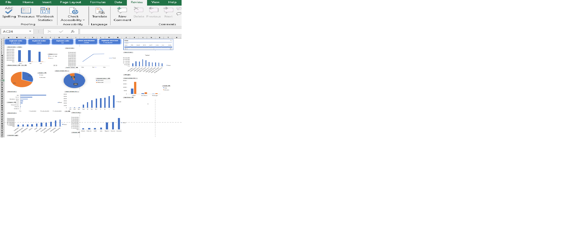

# 📊 CodeAlpha_Visualization_RetailDashboard

**Retail Store Sales Dashboard (Excel)**
CodeAlpha Data Analytics Internship, Task 3 (Data Visualization)

**Author:** Atithi Ashok Salve

---

## 🎯 Objective
Retail store cha sales data (Apr to Jun 2025) vaprun ek interactive Excel dashboard banvne, jyane sales, orders, customers, products, states ani channels cha ek nazar madhe adhava milel.

## 📦 Dataset
- 31,047 order lines, 21 columns (28,471 unique Order IDs)
- Period: 1 Apr 2025 to 12 Jun 2025 (June cha data purna nahi)
- Columns: Order ID, Gender, Age Group, Date, Status, Channel, Category, Size, Qty, sale (INR), ship-city, ship-state, B2B

## 🛠 Tools
Microsoft Excel (PivotTables, PivotCharts, Slicers, Timeline)

## 🖼 Dashboard

## 🧩 Dashboard madhe kay aahe
- **KPI cards:** highest sale, highest order, highest category, more purchases, highest revenue
- **Sales vs Orders** by month (ek chart madhe)
- **Customers:** Gender share, Age Group by Gender
- **Products:** Sales by Category, Sales by Size
- **Geography:** Top states by sales
- **Orders:** Delivered vs Refunded
- **Channels:** Sales by Channel (Amazon, Myntra, Flipkart ityadi)
- **Interactive filters:** Slicers (Category, Gender, Status, Channel) ani Date Timeline

## 📈 Key Insights
| # | Insight |
|---|---|
| 1 | Total sales **₹2.12 crore** (₹21,176,377), **31,047** order lines |
| 2 | **May** madhe sarvat jast sales (₹74.2 lakh, 10,825 orders). June cha data fakt 12 June paryant aahe, mhanun toh kami disto |
| 3 | **Set** category sarvat motha: **49.6%** sales. Tyanantar kurta (23.4%) ani Western Dress (14.9%) |
| 4 | **Amazon** top channel (35.5%). Amazon + Myntra + Flipkart miLun **~80%** sales |
| 5 | **Women** customers cha sales vata **64%** |
| 6 | **Maharashtra** top state (₹29.9 lakh), tyanantar Karnataka ani Uttar Pradesh |
| 7 | **93.1%** sales delivered. Returned 3.4%, Cancelled 2.3%, Refunded 1.3% |
| 8 | **Adult** age group cha vata **83%** sales |

## 💡 Recommendations
1. Set ani kurta category var focus thev ani stock vadhva.
2. Amazon, Myntra, Flipkart var promotions kara. Chhote channels cha vata kami aahe.
3. Women cha products cha range vadhva.
4. Maharashtra, Karnataka ani Uttar Pradesh madhe delivery ani marketing majboot kara.
5. Returns/Refunds (6.9%) kami karnyasathi size ani product details sudharava.

## ⚠️ Limitations
- Data fakt Apr to 12 Jun 2025 cha aahe, mhanun months tulna purna nahi.
- Dashboard "orders" mhanje order lines (rows) mojtat, unique Order ID nahi.

## 📁 Files
- `atithi_store_final.xlsx`: Excel dashboard (data, PivotTables, charts, slicers)
- `dashboard.png`: Dashboard cha screenshot

## 📬 Contact
**Atithi Ashok Salve**: LinkedIn: https://www.linkedin.com/in/atithi-salve-542916421/ · GitHub: https://github.com/atithi-colab

#CodeAlpha #DataAnalytics #DataVisualization #Excel
